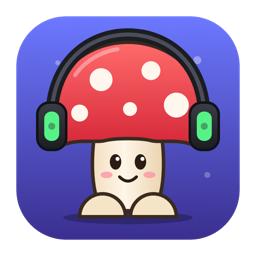

<h1 align="center">TheBigFungie's Soundboard</h1>

Soundboard per Discord e per tutte le call: pad con scorciatoie, i suoni arrivano a chi è in chiamata.

## ⬇️ Scarica

| Sistema | Download |
|---|---|
| **Mac** con chip Apple (M1, M2, M3, M4…) | [soundboard-mac-arm64.zip](https://github.com/aldos1981/thebigfungie-soundboard-releases/releases/latest/download/soundboard-mac-arm64.zip) |
| **Mac** con Intel | [soundboard-mac-x64.zip](https://github.com/aldos1981/thebigfungie-soundboard-releases/releases/latest/download/soundboard-mac-x64.zip) |
| **Windows** 10/11 | [soundboard-win-x64.exe](https://github.com/aldos1981/thebigfungie-soundboard-releases/releases/latest/download/soundboard-win-x64.exe) |

Non sai che Mac hai? Menu  → *Informazioni su questo Mac*: se c'è scritto "Chip Apple M…" prendi il primo.

## Installazione

**Mac**
1. Apri lo zip e trascina *TheBigFungie's Soundboard* in **Applicazioni** (o sulla Scrivania).
2. Al primo avvio macOS dice che non può verificare lo sviluppatore: vai in **Impostazioni di Sistema → Privacy e sicurezza**, in fondo clicca **Apri comunque**. Serve solo la prima volta.
3. Quando chiede il **microfono**, clicca **Consenti**.

**Windows**
1. Apri `soundboard-win-x64.exe`. Se compare *"Windows ha protetto il PC"*: **Ulteriori informazioni → Esegui comunque**. Serve solo la prima volta.

**Poi, su tutti e due:** nell'avviso giallo in alto clicca **Installa microfono virtuale** (su Windows poi riavvia il PC).
In Discord → *Impostazioni → Voce e video* scegli come **dispositivo di input**: `BlackHole 2ch` (Mac) oppure `CABLE Output` (Windows), e spegni *Soppressione del rumore*.

## Aggiornamenti

Automatici: quando esce una versione nuova l'app mostra **🍄 È uscito l'aggiornamento → Aggiorna ora**. Un clic e si aggiorna da sola.
